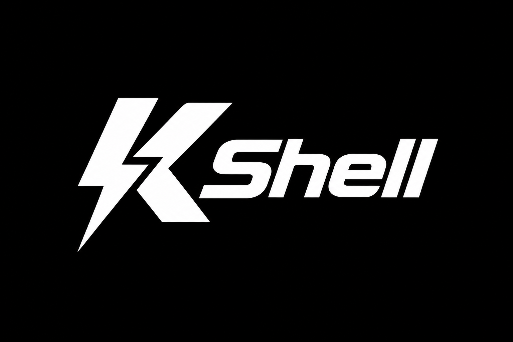

<p align="center">
  
</p>

<h1 align="center">K Shell</h1>

<p align="center">
  K Shell is a fast, customizable, open-source shell built with Rust.<br>
  Linux-style commands, smart autocompletion and syntax highlighting, right in your Windows terminal.
</p>

<p align="center">
  <a href="https://k-shell-windows.berrylorikeet8.chatgpt.site">Website</a> ·
  <a href="https://k-shell-windows.berrylorikeet8.chatgpt.site/docs/">Documentation</a> ·
  <a href="https://github.com/chaovanthoung168/k-shell/releases/latest">Download</a> ·
  <a href="LICENSE">MIT License</a>
</p>

## Features

- **Native Windows execution:** run Windows applications directly from K Shell.
- **Linux-style commands:** navigate folders, manage files, and read or write text.
- **Smart autocompletion:** complete commands and paths, cycle matches, and accept history suggestions.
- **Syntax highlighting:** identify known commands, unsupported syntax, and suggestion status while typing.
- **Customizable appearance:** choose a prompt design, color palette, icons, and suggestion style.
- **Persistent history:** recall previous commands and search them with the keyboard.
- **Developer tools:** install and switch managed versions with KPM in the updated source build.
- **Native HTTP client:** send API requests and inspect JSON with `kreq` in the updated source build.

K Shell targets **Windows 10/11 x64**. It has its own lexer, parser, and runtime;
normal commands execute without a PowerShell, CMD, Git Bash, or WSL parser.
It is an early shell with a deliberately limited command language. See
[current limitations](#current-limitations) before using shell scripts.

**Release availability:** the existing v0.1.6 download does not include KPM or
`kreq`. To use those commands, [build the updated source](#build-from-source)
and launch the executable you just built.

## Contents

- [Tech stack](#tech-stack)
- [Install](#install)
- [Quick start](#quick-start)
- [Configuration](#configuration)
- [Command reference](#command-reference)
- [Package manager: KPM](#package-manager-kpm)
- [HTTP client: kreq](#http-client-kreq)
- [Keyboard shortcuts](#keyboard-shortcuts)
- [Build from source](#build-from-source)
- [Current limitations](#current-limitations)
- [Contributing](#contributing)

## Tech stack

| Technology | Used for |
| --- | --- |
| Rust, edition 2024 | Shell, command language, built-ins, and native process execution. |
| Rust standard library | Filesystem operations, process launching, streams, and shell state. |
| `rustyline` 19 | Interactive line editing, completion, history, and custom key bindings. |
| `windows-sys` 0.61 | Native Windows console, filesystem, registry, process, and hardware APIs. |
| `unicode-width` 0.2 | Terminal-cell measurements for aligned text and icons. |
| `reqwest` 0.12 + Rustls | HTTP requests with native certificate roots, without a curl dependency. |
| Tokio 1 | One shared asynchronous network runtime for KPM and `kreq`. |
| Serde + `serde_json` | Managed installation records, provider metadata, and JSON responses. |
| `sha2` 0.10 + `zip` 4 | SHA-256 verification and guarded ZIP extraction for managed tools. |
| PowerShell + GitHub Actions | Windows installation, packaging, and release automation. |

The companion website uses **Next.js 16, React 19, TypeScript, and CSS**.
Its particle artwork uses **Three.js and React Three Fiber**. The browser
Playground is a simulation; it does not execute K Shell or install software.

## Install

### Install from PowerShell

Open **PowerShell** on Windows 10/11 x64 and run:

```powershell
powershell -NoProfile -ExecutionPolicy Bypass -Command "irm https://raw.githubusercontent.com/chaovanthoung168/k-shell/main/install.ps1 | iex"
```

Close and reopen your terminal, then run:

```powershell
kshell
```

In Windows Terminal, you can also select **K Shell** from the profile dropdown.
No administrator access, Rust installation, WSL, or special font is required.

Setup downloads the latest stable release, verifies the ZIP's SHA-256 checksum,
installs into `%LOCALAPPDATA%\Programs\KShell`, adds that folder to your **user
PATH**, and registers a Windows Terminal profile. It preserves your history and
default Terminal profile. PowerShell's execution-policy override applies only to
setup's process. Run the same installer again to update, after closing K Shell.

### Customize installation

Download and inspect the script before running it with options:

```powershell
Invoke-WebRequest -UseBasicParsing https://raw.githubusercontent.com/chaovanthoung168/k-shell/main/install.ps1 -OutFile install.ps1
Get-Content .\install.ps1
powershell -NoProfile -ExecutionPolicy Bypass -File .\install.ps1 -InstallDirectory 'D:\Apps\KShell' -PathScope None
```

| Installer option | Meaning |
| --- | --- |
| `-Version <version>` | Choose a stable release, such as `0.1.6`; defaults to latest. |
| `-InstallDirectory <path>` | Choose the installation folder. |
| `-PathScope User` | Add K Shell to user PATH; the online installer's default. |
| `-PathScope Process` | Change PATH only in the setup process. |
| `-PathScope None` | Leave PATH unchanged. Launch the executable by its full path. |
| `-NoTerminalProfile` | Skip Windows Terminal profile registration. |
| `-FontFace <name>` | Use a font already installed on your machine. |
| `-NoAnimation` | Use plain installation progress. |
| `-Archive <ZIP>` | Install from a local archive and its adjacent `.sha256` file. |
| `-ChecksumFile <path>` | Specify the local archive's checksum file explicitly. |

### Portable installation

Download the Windows x64 ZIP and matching `.sha256` file from
[Releases](https://github.com/chaovanthoung168/k-shell/releases/latest).
Compare its hash with the supplied checksum:

```powershell
Get-FileHash .\KShell-0.1.6-windows-x64.zip -Algorithm SHA256
```

Use the filename of your downloaded version. Extract the entire ZIP, then run
`kshell.exe`. For a per-user installation, run the included `Install.ps1` instead.
That packaged installer leaves PATH unchanged unless you pass `-PathScope User`.
Releases are unsigned Windows x64 builds.

### Uninstall

Close K Shell, remove its installation folder, and remove its K Shell Windows
Terminal fragment at `%LOCALAPPDATA%\Microsoft\Windows Terminal\Fragments\K Shell`.
If added, remove the installation folder from your user PATH in Windows
Environment Variables. Keep your history and configuration folders if you want
to reuse them. For KPM-managed developer tools, use `kpm uninstall` before
removing K Shell; deleting the shell does not uninstall those tools.

## Quick start

Run these lines separately **inside K Shell**:

```text
pwd
ls -la
mkdir -p demo/src
create demo/src/main.rs
write demo/notes.txt 'Hello from K Shell'
append demo/notes.txt 'My first project'
cat demo/notes.txt
tree -L 2
help
```

Quote paths containing spaces, for example `cd 'C:\Program Files'`.
Backslashes remain literal, including inside quotes. Single and double quotes
preserve spaces and empty arguments. Use `help <command>` for examples.

## Configuration

### Choose a prompt

Inside K Shell, run:

```text
theme
```

Use **Up/Down** to preview, **Enter** to install and save a design, or
**Esc / Ctrl+C** to cancel. Designs are bundled and installed offline.
The original `default` prompt is available without installing another design.

| Command | Meaning |
| --- | --- |
| `theme` | Open the interactive prompt picker. |
| `theme list` | List bundled optional prompt designs. |
| `theme install <name>` | Install a bundled design without activating it. |
| `theme <name>` | Activate an installed design and save it for future sessions. |
| `theme default` | Restore and save the original prompt. |
| `theme status` | Show the prompt, palette, icons, and suggestion style. |
| `theme ocean` | Use the Ocean color palette for this session. |
| `theme dusk` | Use the Dusk color palette for this session. |
| `theme midnight` | Use the Midnight color palette for this session. |
| `theme icons unicode\|nerd\|off` | Select standard icons, Nerd Font icons, or no icons. |
| `theme suggestions soft\|bold\|underline` | Choose how suggestions are displayed. |
| `theme reset` | Reset appearance for this session. |
| `theme --help` | Show all appearance options. |

Optional designs: `powerline`, `atomic`, `bubblesline`, `cert`, and `negligible`.
For example:

```text
theme install atomic
theme atomic
theme dusk
theme icons unicode
theme suggestions soft
```

Prompt selection persists. Palette, icon, and suggestion commands apply to the
current session. Nerd icons require an installed Nerd Font Mono; if icons appear
as boxes, use `theme icons unicode` or `theme icons off`. K Shell does not install
fonts or change the terminal host's font and background.

### Set startup defaults

Set environment variables in **PowerShell before launching K Shell**:

```powershell
$env:KSHELL_THEME = 'dusk'
$env:KSHELL_ICONS = 'unicode'
$env:KSHELL_SUGGESTION_STYLE = 'soft'
kshell
```

Add those assignments to your PowerShell profile to reuse them for shells
launched from PowerShell, or set user environment variables in Windows Settings.
Startup flags override appearance environment settings:

```powershell
kshell --theme midnight --icons unicode --suggestions soft
```

| Setting | Meaning |
| --- | --- |
| `KSHELL_THEME` | Startup palette: `ocean`, `dusk`, or `midnight`. |
| `KSHELL_ICONS` | Startup icons: `unicode`, `nerd`, or `off`. |
| `KSHELL_SUGGESTION_STYLE` | Suggestions: `soft`, `bold`, or `underline`. |
| `KSHELL_CONFIG_DIR` | Override the prompt configuration folder; empty disables prompt persistence. |
| `KSHELL_HISTORY_FILE` | Override the history file; empty disables history persistence. |
| `KSHELL_KPM_HOME` | Override KPM's absolute private storage root; empty disables KPM storage. |
| `KSHELL_KPM_FPS` | KPM progress refresh rate, 5–60 FPS; defaults to 30. |
| `NO_COLOR` | Disable shell color and underline styling; icons are configured separately. |

Legacy `MYSH_THEME`, `MYSH_ICONS`, `MYSH_SUGGESTION_STYLE`, `MYSH_HISTORY_FILE`,
and `MYSH_KPM_HOME` are accepted when their corresponding `KSHELL_*` setting is
absent. An explicitly empty `KSHELL_*` value takes precedence.

| Stored data | Default location |
| --- | --- |
| Prompt designs and selection | `%APPDATA%\kshell` (home fallback: `.kshell`). |
| Command history | `%APPDATA%\mysh\history.txt` (home fallback: `.mysh/history.txt`). |
| KPM installations and records | `%LOCALAPPDATA%\KShell\kpm`. |

History retains up to 1,000 entries. Start a command with a space to keep it out
of history. History is saved for interactive sessions; `-c` and batch sessions
have no interactive history.

### Windows Terminal profile

After a source build, register the bundled profile from the repository root:

```powershell
.\contrib\windows-terminal\Install-KShellProfile.ps1
wt -p 'K Shell'
```

The script uses an installed Meslo Nerd Font Mono when available, otherwise
Consolas with Unicode icons. It changes only its own profile fragment and backs
up an earlier copy. Use `-FontFace <name>` to select an installed font,
`-Preview` to inspect the fragment, or `-Executable <path>` for a custom build.

## Command reference

These are **all built-in command names and aliases in this source tree**.
`[value]` means optional; `...` means multiple values. Only documented flags
are supported. Use `--` before a filename beginning with `-` where the usage
shows `[--]`.

### Navigation and files

| Command | Meaning |
| --- | --- |
| `pwd` | Print the current folder. |
| `cd [folder]` | Change folder; no argument returns to your home folder. |
| `ls [-al] [path ...]` | List files. `-a` includes hidden entries; `-l` shows file kind and byte size. |
| `tree [-ad] [-L depth] [--] [folder]` | Show a folder tree. `-a` includes hidden entries, `-d` shows folders only, and `-L` limits depth. |
| `mkdir [-p] folder ...` | Create folders; `-p` also creates missing parents. |
| `create [--] file ...` | Create new empty files; reject existing entries without modifying them. |
| `touch file ...` | Create missing files or update existing file timestamps. |
| `cat [file ...]` | Print file bytes; no filename, or `-`, reads standard input. |
| `write [--] file text ...` | Create or replace a file with UTF-8 text and a final newline. |
| `append [--] file text ...` | Append UTF-8 text and a final newline; create the file if missing. |
| `cp [-r] source destination` / `copy` | Copy one file or folder; `-r` is required for folders. |
| `mv source destination` / `move` | Move one file or folder. |
| `rename source new-name` / `update` | Rename an item within its current folder; the new name must be a leaf filename. |
| `rm [-rf] path ...` / `delete` | Permanently delete entries; `-r` removes folders recursively and `-f` ignores missing paths. |
| `open [--] file` | Open a document or media file with its Windows default app; executable and batch files are rejected. |

`cp`/`copy`, `mv`/`move`, and `rename`/`update` reject overwriting existing
entries. Parent folders must already exist for file creation and text writes.
`write` replaces existing content; `rm`/`delete` bypass the Recycle Bin.
Recursive operations guard links/reparse points and protected source locations;
file operations are not transactional.

### Session, appearance, and system

| Command | Meaning |
| --- | --- |
| `echo [text ...]` | Print arguments separated by spaces, followed by a newline; flags such as `-n` are literal text. |
| `clear` | Clear the visible terminal and scrollback. |
| `history [count]` | List retained commands, or only the most recent `count` entries. |
| `help [topic]` | Browse command usage and examples. Topics include command names, `all`, `shortcuts`, `navigate`, `files`, `manage`, `session`, `customize`, `system`, and `tools`. |
| `kshell [--welcome]` | Show the welcome banner inside the current session. |
| `theme [option]` | Configure prompt design, palette, icons, and suggestions; see [configuration](#configuration). |
| `sysinfo` / `specs` | Show native Windows OS, user, CPU, GPU, usable RAM, and local drive information. |
| `exit [0-255]` | Exit with the supplied status, or the previous command's status. |
| `kpm <command>` | Install and manage developer tools; updated source build only. |
| `kreq <METHOD> <URL> [options] [content\|headers]` | Make HTTP requests; updated source build only. |

### External programs

K Shell also launches native Windows programs found on PATH. These commands
belong to their respective applications, with their own options and help:

| Command | Meaning / requirement |
| --- | --- |
| `git [arguments]` | Git version control; requires Git for Windows. |
| `ssh [options] user@host` | Connect through native OpenSSH; requires an available SSH client. |
| `curl [options] URL` | HTTP requests and downloads; uses native curl when available. |
| `nano [file]` | Edit text with GNU nano; K Shell can discover Git for Windows' bundled Nano. |
| `code [path]` | Open VS Code; requires VS Code. Its native CLI adapter avoids executing `code.cmd`. |
| `node [arguments]` | Run JavaScript with Node.js. |
| `npm [arguments]` | Manage Node.js packages and scripts through the selected Node/npm installation. |
| `npx [arguments]` | Run an npm-provided tool through the selected Node/npm installation. |
| `python [arguments]` | Run Python. |
| `go [arguments]` | Use the Go toolchain. |
| `rustc [arguments]` | Compile Rust source. |
| `cargo [arguments]` | Build and manage Rust projects. |
| `php [arguments]` | Run PHP. |
| `java [arguments]` | Run Java programs. |
| `javac [arguments]` | Compile Java source; requires a full JDK. |

Install these programs separately or through a supported KPM provider. Git's
bundled Nano is a discovery fallback, not part of K Shell. SSH leaves host keys,
authentication, and SSH configuration to OpenSSH. `curl` keeps its own HTTP/TLS
behavior; `kreq` is an independent native client.

### Launch options

Run these from **PowerShell or Command Prompt**:

| Invocation | Meaning |
| --- | --- |
| `kshell` | Start an interactive session when stdin and stdout are terminals. |
| `kshell -c "<command>"` | Execute one command and return its status. |
| `kshell --theme ocean\|dusk\|midnight` | Set the startup palette. |
| `kshell --icons unicode\|nerd\|off` | Set startup icons. |
| `kshell --suggestions soft\|bold\|underline` | Set startup suggestion styling. |
| `kshell --welcome` | Display the welcome banner and exit. |
| `kshell --help` | Show executable usage. |

Put appearance options before `-c`. Command-mode and redirected utility output
remain plain and omit interactive prompts and decoration.

## Package manager: KPM

**Updated source build only.** Run `kpm install` to select one tool, or
`kpm install node` to select a version. The menu shows a Latest Stable shortcut,
the five newest distinct stable releases, and Other version for manual entry.
Use Up/Down, Enter, and Esc/Ctrl+C. Only one tool is accepted per installation.

| Command | Meaning |
| --- | --- |
| `kpm list` | List the seven supported tools and provider capabilities. |
| `kpm search <query>` | Search the supported tool catalog. |
| `kpm versions <tool>` | Discover available stable releases. |
| `kpm install` | Choose one tool and then a version interactively. |
| `kpm install <tool>` | Open that tool's version menu. |
| `kpm install <tool>@<version>` | Validate and install a specific available version after confirmation. |
| `kpm install <tool>@latest --yes` | Install the latest stable release without confirmation. |
| `kpm installed [tool]` | List recorded managed installations. |
| `kpm current <tool>` | Verify and show the active managed version. |
| `kpm use <tool>[@version]` | Select an installed managed version, without downloading anything. |
| `kpm upgrade <tool>[@version]` | Select and install a newer supported isolated version, retaining older ones. |
| `kpm uninstall <tool>@<version>` | Remove a recorded managed installation, confirming deactivation if active. |
| `kpm recover` | Inspect interrupted installation work, recording verified completion or cleaning safe marked staging. |
| `kpm --help` | Show syntax, provider limits, storage, and progress settings. |

| Tool | Provider and version support |
| --- | --- |
| `node` | Official ZIP + SHA-256; isolated versions, switching, and matching npm/npx. |
| `python` | WinGet, user scope; one managed version. Switching and in-place upgrades are unsupported. |
| `go` | Official SDK ZIP + SHA-256; isolated versions and switching. |
| `rust` | Existing rustup client; private Rust/Cargo homes, pinned MSVC toolchains, and switching. |
| `php` | Official NTS x64 ZIP + SHA-256; isolated versions and switching. Requires a matching Visual C++ runtime. |
| `git` | WinGet, user scope; one managed version. Switching and in-place upgrades are unsupported. |
| `java` | Full Eclipse Temurin JDK 17+, including `javac`; isolated JDKs, switching, and child `JAVA_HOME`. |

For example, `kpm install java@21` resolves the newest available Temurin JDK 21
patch/build, then confirms installation. `kpm use java@21` selects an installed
managed JDK 21; `java -version` and `javac -version` verify its runtime/compiler.

Noninteractive install/upgrade requires an explicit `@version` or `@latest`
**and** `--yes`. The flag skips confirmation, never validation. Noninteractive
uninstall/recover also requires `--yes`. In a terminal, `--yes` alone does not
skip an unspecified version's menu.

Selections take effect immediately and persist across shell restarts. Managed
PATH, `JAVA_HOME`, `GOROOT`, and Rust variables apply to K Shell's child processes.
KPM never changes system PATH or requests administrator elevation. Python/Git
installers must support a verifiable user installation at the private destination;
existing unmanaged packages are not adopted. PHP discovery is limited to its
provider's currently published releases JSON. Rust requires an existing rustup
client; KPM does not bootstrap it.

The first switchable installation activates after verification. With another
version active, interactive installation offers activation; `--yes` preserves
that existing selection. Downloads and managed records are verified before
success is reported. Automated tests use mock providers and local fixtures;
live installation across all seven upstreams still needs separate verification.

Read the [full KPM guide](docs/kpm.md) for installation trust, cancellation,
recovery, active-version removal, and provider details.

## HTTP client: kreq

**Updated source build only.** Send HTTP requests without a separate curl
installation. Supported methods are `get`, `post`, `put`, `patch`, `delete`,
`head`, and `options`, case-insensitively.

```text
kreq get 'https://api.example.com/users/1'
kreq get 'https://api.example.com/users/1' --json
kreq get 'https://api.example.com/users/1' --json content
kreq get 'https://api.example.com/users/1' headers
kreq post 'https://api.example.com/users' -H 'Content-Type: application/json' -d '{"name":"John"}'
kreq get 'https://example.com/download.zip' -L -o download.zip
kreq --help
```

The API URLs above are placeholders; replace them with your service.
Interactive output shows `StatusCode` (such as `200 OK`), `Content`,
`RawContent`, and `Headers`. A final `content` or `headers` selector keeps
StatusCode and only that field; `header` aliases `headers`. `--json` formats
JSON inside Content. Headers view skips downloading/parsing the body.

| Option | Meaning |
| --- | --- |
| `-j`, `--json` | Parse and pretty-print JSON; invalid JSON returns an error. |
| `--raw` | Show only the body, without the terminal summary. |
| `-H`, `--header <header>` | Add a request header; repeat as needed. |
| `-d`, `--data <text>` | Send the exact supplied request body. |
| `-o`, `--output <file>` | Save original response bytes, overwriting a regular file; parents must exist. |
| `-i`, `--include` | Include response headers on stdout in raw/batch/file modes. |
| `-v`, `--verbose` | Show request/response details on stderr with credential-header redaction. |
| `-L`, `--location` | Follow up to ten redirects. |
| `-X`, `--request <method>` | Override or supply the request method. |
| `--timeout <seconds>` | Set total request timeout; default 30, maximum 86400. |
| `--fail` | Return status 22 for HTTP 4xx/5xx while retaining response output. |
| `-h`, `--help` | Show the complete HTTP-client usage. |

`--json` changes response formatting; set a request's Content-Type explicitly.
Raw/batch output preserves body bytes without an added newline; file output
keeps original bytes even with `--json`. Headers view writes a status/header
block instead. Ctrl+C cancels interactive requests. Shell `>` and pipes are not
implemented; use `-o` for files inside K Shell.

Read the [full kreq guide](docs/kreq.md) for response examples, security,
redirect rules, error statuses, and binary output behavior.

## Keyboard shortcuts

| Key | Action |
| --- | --- |
| **Tab** | Accept a visible suggestion, or complete a command/path; press again to cycle matches. |
| **Right arrow** | Accept the suggested suffix at the end of the input line. |
| **Up / Down** | Browse command history. |
| **Ctrl+R** | Search history. |
| **Ctrl+L** | Clear the screen and scrollback while keeping current input. |
| **Ctrl+C** | Cancel input or interrupt a foreground program. |
| **Ctrl+D** | Exit when the input line is empty. |
| **Enter** | Execute the current command. |

Suggestions use local syntax checks and remembered command results; they do not
run commands while you type. External arguments may remain unverified.

## Build from source

Install stable Rust and the Windows MSVC build tools. From the Rust repository
root containing `Cargo.toml`, run in **PowerShell**:

```powershell
cargo build --locked
.\target\debug\kshell.exe
```

For one command:

```powershell
.\target\debug\kshell.exe -c "echo 'Hello from K Shell'"
```

If an existing debug executable is running, close it before rebuilding, or
choose a separate build directory:

```powershell
cargo build --locked --target-dir target\local
.\target\local\debug\kshell.exe
```

For a distributable Windows x64 ZIP, first cache the locked dependency graph:

```powershell
cargo fetch --locked
.\scripts\Build-Release.ps1
```

Find the ZIP and checksum in `target/packages`. The package includes the native
executable, installer, Terminal-profile helper, quick-start guide, and license
notices. Recipients do not need Rust. Use a fresh `-OutputDirectory` when
building another package; existing ZIPs are not overwritten.

## Current limitations

- Pipes, redirection, `&&`, `||`, command separators, and background execution are not implemented. Unsupported operators are rejected before execution.
- Variables, `$NAME`, `${NAME}`, `$?`, `~`, assignments, and globbing are not expanded; they remain literal. `export`, `unset`, aliases, and full scripting are unavailable.
- `grep`, `find`, and `which` are not built-ins yet; the command table above reflects implemented commands.
- Direct `.cmd`/`.bat` execution is rejected. The npm/npx and VS Code adapters invoke native executables with known packaged CLI scripts; they do not add general batch compatibility.
- K Shell runs Windows applications; Linux ELF binaries require a compatible environment.
- User-authored prompt templates and full Bash/Zsh compatibility are not implemented.
- Redirected line-mode input may buffer later commands; use `-c` when a child program needs redirected stdin.
- General foreground programs control their own Ctrl+C behavior. Forced cleanup of programs that ignore it remains limited; KPM separately owns its installer process jobs.

## Contributing

Work from the Rust repository root and read [AGENTS.md](AGENTS.md) for architecture
and contribution guidelines. Validate code changes with:

```powershell
cargo fmt --check
cargo test --locked
cargo clippy --locked --all-targets -- -D warnings
```

Tests use temporary files and local fixtures. KPM tests do not install real
software or contact public providers. See [DESIGN.md](DESIGN.md) for appearance
decisions. To publish a release, update the Cargo version and push a matching
`vMAJOR.MINOR.PATCH` tag; the release workflow packages and checks the Windows
build before publishing assets.

## License

K Shell is open source under the [MIT License](LICENSE).
